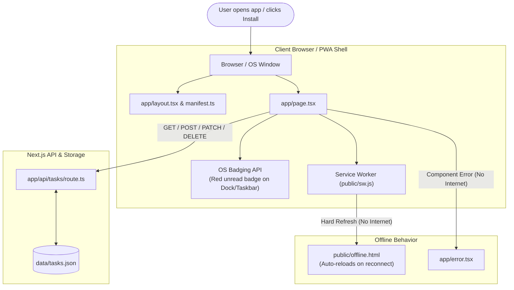

# YHD Tasks POC: High-Level Architecture, Flows, and PWA vs Traditional Web Comparison

---

## 1. PWA in Plain English (Zero Experience Guide)

A **Progressive Web App (PWA)** is a standard website built using web technologies (HTML, CSS, JavaScript, React/Next.js) that has been enhanced to behave like an **installed native application** on your phone (Android/iOS) or computer (Windows, macOS, Linux).

Instead of requiring users to search in an App Store, download 100MB+ binaries, and wait for updates, a PWA installs directly from the browser in a few kilobytes.

### The Two Core Pillars of a PWA
1. **Web App Manifest (`manifest.ts` or `manifest.json`)**:
   - The app's **Identity Card**.
   - It tells the operating system: *"Here is my app name, my desktop/mobile app icons, my theme color, and please open me in a dedicated standalone window without a browser address bar."*
2. **Service Worker (`sw.js`)**:
   - The app's **Silent Background Assistant**.
   - It is a special JavaScript script that runs separately from web pages. It sits between the browser and the internet network, intercepting requests to catch offline errors or cache essential fallback assets.

---

## 2. High-Level Overview of the To-Do POC

The **YHD Tasks POC** was built with **Next.js 14 (App Router)** and **Tailwind CSS** to prove that modern web applications can deliver native desktop and mobile app experiences while maintaining strict enterprise data integrity.

### Primary Objectives Demonstrated
1. **Zero-Address-Bar Standalone Windowing**: Opens in its own operating system process (alt-tabable, pinnable to Taskbar/Dock/Home Screen).
2. **Native OS App Badging API**: Dynamically updates an unread notification count badge on the native OS icon.
3. **Hard Navigation Offline Defense**: Protects against browser crash screens (the "dinosaur" error) by serving a branded, auto-recovering offline fallback.
4. **Network-Only Data Integrity**: Avoids stale cached student or attendance records by intentionally keeping data live and server-synced.
5. **Cross-Device Cloud Sync**: Live polling allows real-time state synchronization across desktop and mobile devices.

---

## 3. End-to-End System Flows



### Flow 1: Installation & Launch
1. A user visits `http://localhost:3000` (or the HTTPS Cloudflare tunnel URL on mobile).
2. The browser parses [app/manifest.ts](file:///home/himoneesh-sharma/Downloads/workspace/us-yhd-website/pwa-todo-poc/app/manifest.ts).
3. The browser triggers the `beforeinstallprompt` event. [app/page.tsx](file:///home/himoneesh-sharma/Downloads/workspace/us-yhd-website/pwa-todo-poc/app/page.tsx) captures this and displays a branded **"Install"** button.
4. When the user clicks **Install**, the OS creates a desktop shortcut or mobile WebAPK.
5. Launching the shortcut opens the app in `display: standalone` mode (no URL bar, no tabs, no browser bookmarks).

### Flow 2: Live Sync & Badging
1. On mount, [app/page.tsx](file:///home/himoneesh-sharma/Downloads/workspace/us-yhd-website/pwa-todo-poc/app/page.tsx) fetches task items from [app/api/tasks/route.ts](file:///home/himoneesh-sharma/Downloads/workspace/us-yhd-website/pwa-todo-poc/app/api/tasks/route.ts).
2. The client calculates the total count of pending (uncompleted) tasks.
3. It invokes `navigator.setAppBadge(pendingCount)`:
   - On Windows, a red badge with the number appears over the Taskbar icon.
   - On macOS, a badge appears on the Dock icon.
   - For unsupported environments (like Linux or standard browser tabs), it dynamically prepends the count to the page title `(N) YHD Tasks POC`.
4. The client polls the API every 5 seconds and whenever the window regains focus (`visibilitychange`), keeping desktop and mobile instances in sync.

### Flow 3: Handling Loss of Internet (Offline Defense)
1. **Hard Navigation (Reload)**: If a user hard-refreshes (`Ctrl+R` / `F5`) while disconnected:
   - [public/sw.js](file:///home/himoneesh-sharma/Downloads/workspace/us-yhd-website/pwa-todo-poc/public/sw.js) intercepts the `mode: 'navigate'` request.
   - Since network fetch fails, it serves [public/offline.html](file:///home/himoneesh-sharma/Downloads/workspace/us-yhd-website/pwa-todo-poc/public/offline.html) from the cache.
   - The offline screen monitors network state with `window.addEventListener('online')` and automatically reloads the app the second internet connectivity is restored.
2. **Soft Navigation (In-App Action)**: If a background fetch fails during an active session, [app/error.tsx](file:///home/himoneesh-sharma/Downloads/workspace/us-yhd-website/pwa-todo-poc/app/error.tsx) catches the failure and displays a friendly retry card instead of breaking the UI.

---

## 4. File-by-File Breakdown

| File | Primary Responsibility | PWA Role |
| :--- | :--- | :--- |
| [app/manifest.ts](file:///home/himoneesh-sharma/Downloads/workspace/us-yhd-website/pwa-todo-poc/app/manifest.ts) | Defines app metadata, name, theme colors, icons, and display mode. | **Identity & Installation**: Tells the OS how to install and package the app window. |
| [public/sw.js](file:///home/himoneesh-sharma/Downloads/workspace/us-yhd-website/pwa-todo-poc/public/sw.js) | Minimal Service Worker intercepting page navigation requests. | **Network Interception**: Serves the branded offline fallback without caching stale data. |
| [public/offline.html](file:///home/himoneesh-sharma/Downloads/workspace/us-yhd-website/pwa-todo-poc/public/offline.html) | Lightweight standalone HTML shell. | **Offline Defense**: Renders a branded offline notice and auto-reloads upon reconnection. |
| [app/layout.tsx](file:///home/himoneesh-sharma/Downloads/workspace/us-yhd-website/pwa-todo-poc/app/layout.tsx) | Root layout injecting mobile viewport and Apple Web App meta tags. | **Native Shell Styling**: Configures `viewportFit: cover` and iOS status bar styling. |
| [app/page.tsx](file:///home/himoneesh-sharma/Downloads/workspace/us-yhd-website/pwa-todo-poc/app/page.tsx) | Main client interface, CRUD logic, polling, and badging hooks. | **State & OS APIs**: Registers SW, controls install prompts, and calls Badging API. |
| [app/error.tsx](file:///home/himoneesh-sharma/Downloads/workspace/us-yhd-website/pwa-todo-poc/app/error.tsx) | Next.js client-side error boundary. | **Soft Navigation Defense**: Catches network dropped requests during page interactions. |
| [app/api/tasks/route.ts](file:///home/himoneesh-sharma/Downloads/workspace/us-yhd-website/pwa-todo-poc/app/api/tasks/route.ts) | Next.js Route Handler handling `GET`, `POST`, `PATCH`, `DELETE`. | **Backend API**: Persists changes to disk for cross-client sync. |
| [data/tasks.json](file:///home/himoneesh-sharma/Downloads/workspace/us-yhd-website/pwa-todo-poc/data/tasks.json) | Local JSON file storage. | **Persistence**: Stores mock school/yearhead tasks. |

---

## 5. Normal Website vs. PWA: What are the Differences?

When an application is built as a **standard website**, it lives completely inside the browser's sandbox. When upgraded to a **PWA**, you unlock progressive capabilities (add-on types) that bridge the gap between web and native apps.

### Comprehensive Comparison Matrix

| Feature / Dimension | Standard Website | Progressive Web App (PWA) |
| :--- | :--- | :--- |
| **Launch Experience** | Must open browser, type URL, or click a bookmark. | Tap app icon on Home Screen, Taskbar, or App Drawer. |
| **Window Frame** | Trapped inside browser tabs, search omnibar, back/forward buttons, and bookmark ribbons. | Clean, standalone window with no browser interface (looks 100% like a native app). |
| **Multitasking & OS Presence** | Grouped inside browser tabs; cannot be isolated in `Alt+Tab` or Dock. | Has its own independent OS window and process entry in `Alt+Tab` and Dock/Taskbar. |
| **Icon Badges** | Only browser tab title changes `(3) Website Name`. | Native red badge directly on the OS taskbar/dock icon showing pending task count. |
| **Offline Resilience** | Browser displays default network failure screen ("No Internet Dinosaur"). | Branded offline shell with auto-reconnection detection and retry mechanics. |
| **Installation Mechanism** | None (bookmarks only). | Native install prompts, WebAPK generation on Android, Add to Dock on macOS. |
| **App Shortcuts** | Not supported. | Right-clicking the app icon shows quick jump actions (e.g., "Add New Task"). |
| **Distribution & Updates** | Immediate (on web server), but lacks native device presence. | Instant updates on web server + zero App Store approval delays, yet installed like a native app. |
| **Installation Size** | N/A (cached in browser temp storage). | Extremely light (typically < 1–5 MB vs 50–150 MB for compiled native apps). |

---

## 6. Categorized Breakdown of PWA "Add-On" Types

When planning a PWA implementation, features fall into five distinct **Add-On Types**:

```
                       ┌────────────────────────────────────────┐
                       │           PWA ADD-ON LAYERS            │
                       └────────────────────────────────────────┘
                                            │
         ┌──────────────────┬───────────────┴───────────────┬──────────────────┐
         ▼                  ▼                               ▼                  ▼
┌─────────────────┐┌─────────────────┐             ┌─────────────────┐┌─────────────────┐
│ 1. Identity &   ││ 2. Windowing &  │             │ 3. OS & Device  ││ 4. Network &    │
│    Installation ││    Display      │             │    Integration  ││    Resilience   │
├─────────────────┤├─────────────────┤             ├─────────────────┤├─────────────────┤
│• Web Manifest   ││• display:       │             │• App Badging    ││• Service Worker │
│• Custom Install ││  standalone     │             │• App Shortcuts  ││• Offline Shell  │
│• App Icons      ││• Theme Color    │             │• Share Target   ││• Background     │
│• Splash Screens ││• Fullscreen/    │             │• File Handlers  ││  Sync           │
│                 ││  Minimal-UI     │             │                 │                  │
└─────────────────┘└─────────────────┘             └─────────────────┘└─────────────────┘
                                            │
                                            ▼
                                   ┌─────────────────┐
                                   │ 5. Engagement & │
                                   │    Re-engagement│
                                   ├─────────────────┤
                                   │• Push           │
                                   │  Notifications  │
                                   │• Periodic Sync  │
                                   └─────────────────┘
```

### Type 1: Identity & Installation Add-Ons
- **Web App Manifest**: Provides the application name, short name, high-resolution icons (192px, 512px, maskable), and splash screens.
- **Install Prompt Control (`beforeinstallprompt`)**: Allows developers to create in-app "Install App" buttons instead of relying solely on hidden browser menus.
- **Home Screen & App Drawer Placement**: On mobile (Android WebAPK), the app is indexed as a real OS application.

### Type 2: Windowing & Display Add-Ons
- **`display: 'standalone'`**: Strips away browser navigation bars, tabs, and menus, giving the full screen to your application.
- **Theme Color Synchronization**: Paints the mobile status bar and desktop window header with the app's brand color (`#1e293b`).
- **`viewportFit: 'cover'`**: Adapts layouts to mobile notches, camera cutouts, and bottom navigation pill bars.

### Type 3: OS & Hardware Integration Add-Ons
- **App Badging API (`navigator.setAppBadge`)**: Allows the app to show a dynamic badge counter on the desktop Taskbar or mobile icon (used in our POC for pending task count).
- **App Shortcuts Menu**: Quick action shortcuts accessible by long-pressing on mobile or right-clicking on desktop (e.g., jump directly to `/#new`).
- **Web Share Target & File Handling**: Allows the app to receive shared links, text, or files from other apps on the device.

### Type 4: Network Interception & Resilience Add-Ons
- **Service Worker Lifecycle**: A background thread that can intercept all network traffic.
- **Caching Strategies**:
  - *Network-Only with Fallback* (Our POC choice: prevents stale data while providing a branded offline shell).
  - *Stale-While-Revalidate* (For static assets: images, fonts, styles).
  - *Cache-First* (For immutable bundles).
- **Auto-Reconnection Loops**: Client-side network listeners (`online`/`offline`) that automatically resume state without manual user refresh.

### Type 5: Engagement & Re-engagement Add-Ons
- **Web Push Notifications**: Delivers push alerts even when the browser or app window is completely closed.
- **Background Sync**: Queues actions performed offline (e.g., submitting a note) and silently sends them to the server as soon as the device reconnects.

---

## 7. Which Add-Ons Are Implemented in this POC?

In this specific POC, we intentionally activated high-impact, zero-risk add-ons while adhering to enterprise safety constraints:

| Add-On Feature | Status in POC | Implementation Location |
| :--- | :--- | :--- |
| **Standalone Display Mode** | Active | [app/manifest.ts](file:///home/himoneesh-sharma/Downloads/workspace/us-yhd-website/pwa-todo-poc/app/manifest.ts#L9) |
| **In-App Custom Install Prompt** | Active | [app/page.tsx](file:///home/himoneesh-sharma/Downloads/workspace/us-yhd-website/pwa-todo-poc/app/page.tsx#L94-L100) |
| **Native OS App Badging** | Active | [app/page.tsx](file:///home/himoneesh-sharma/Downloads/workspace/us-yhd-website/pwa-todo-poc/app/page.tsx#L124-L131) |
| **Hard Navigation Offline Defense** | Active | [public/sw.js](file:///home/himoneesh-sharma/Downloads/workspace/us-yhd-website/pwa-todo-poc/public/sw.js#L35-L47) & [public/offline.html](file:///home/himoneesh-sharma/Downloads/workspace/us-yhd-website/pwa-todo-poc/public/offline.html) |
| **Soft Navigation Offline Defense** | Active | [app/error.tsx](file:///home/himoneesh-sharma/Downloads/workspace/us-yhd-website/pwa-todo-poc/app/error.tsx) |
| **Quick Action Shortcuts** | Active | [app/manifest.ts](file:///home/himoneesh-sharma/Downloads/workspace/us-yhd-website/pwa-todo-poc/app/manifest.ts#L33-L40) |
| **Dynamic Offline Data Caching** | *Disabled by Design* | Kept disabled to ensure attendance and student safety records are always live. |
| **Push Notifications / Background Sync** | *Deferred to Phase 2* | Requires VAPID key infrastructure and backend push gateway. |
